*English* · [Русский](README.ru.md)

<p align="center">
  
</p>

<h1 align="center">Mangosteen for Linux</h1>

<p align="center">
  <b>Zero-click file converter and toolbox for Linux.</b><br>
  Start dragging a file, tap Shift, Ctrl or Alt, drop it on a segment — done.
</p>

<p align="center">
  
  
  
  
  <a href="LICENSE"></a>
</p>

---

The Linux sibling of [Mangosteen](https://github.com/SpaceCadet0/Mangosteen) for macOS and
[Mangosteen for Windows](https://github.com/SpaceCadet0/Mangosteen-Windows). It lives in the system tray and waits
for a drag. Start dragging files out of your file manager, tap a modifier key, and a round wheel opens at the pointer.
Drop the files on a segment and the result appears next to the original. No windows to open, no save dialogs, no
uploads, no limits. The apps share no code; each has its own releases.

<p align="center">
  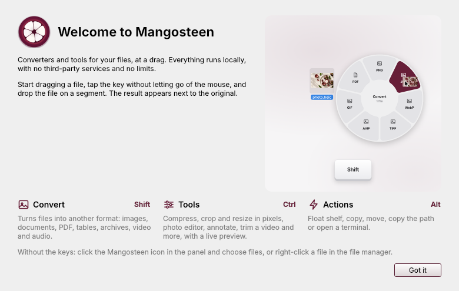
</p>

| Tap while dragging | Wheel | What it does |
|:---:|:---:|---|
| `Shift` | **Convert** | Turns the files into another format |
| `Ctrl` | **Tools** | Opens an editor with a live preview |
| `Alt` | **Actions** | Float shelf, copy, move, path, terminal |

The keys are configurable in Settings. Start dragging a file, tap the key (press and release it) without letting go of
the mouse, and the wheel appears at the pointer; drop the file on a segment. Picked the wrong wheel? Tap another key
to switch.

<p align="center">
  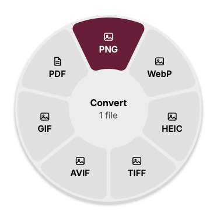
  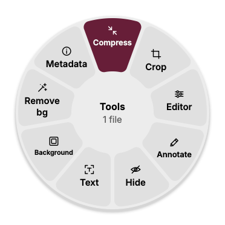
  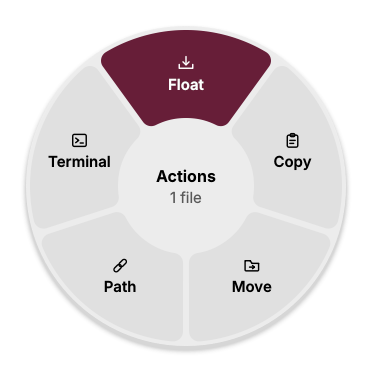
</p>

## Highlights

- **Zero clicks.** The wheel shows only what makes sense for the files you are dragging.
- **Never touches the original.** Results are written next to the source; names never clash (`photo 2.jpg`).
- **Fully offline.** Everything runs on your computer. Nothing is uploaded, nothing is tracked.
- **No limits.** Any number of files, any size, as often as you like.
- **Native.** Qt 6, follows your light or dark theme, desktop notifications, works from the tray.
- **Three languages.** English, Spanish and Russian, following your system or chosen in Settings.

## Convert

| Kind | Formats |
|---|---|
| Images | PNG, JPG, WebP, HEIC, TIFF, AVIF, GIF, PDF (several photos make one PDF); also reads BMP, ICO, ICNS, SVG, PSD, JPEG 2000, TGA |
| PDF | to PNG or JPG (several pages become a folder of pages), TXT, Markdown, RTF, DOCX, HTML |
| Documents | DOCX, ODT, RTF, TXT, Markdown, HTML into each other and into PDF |
| Tables | CSV, TSV, XLSX |
| Subtitles | SRT, VTT, TXT |
| Video | MP4, MOV, MKV, WebM, AVI, WMV into each other, GIF and MP3 |
| Audio | MP3, M4A, WAV, FLAC, OGG, Opus, AIFF, WMA |
| Archives and folders | ZIP, TAR, TGZ |

Video and audio need FFmpeg (bundled in the AppImage, a dependency of the .deb). Formats that cannot be written
(for example HEIC without its library) are left off the wheel instead of failing later.

## Tools

Each tool opens a window with a live preview, saves the result next to the original, and never changes the original.

| Tool | What it does |
|---|---|
| **Crop** and **Size** | Crop by dragging, by aspect ratio or exact pixels; turn and mirror; cut into a grid of parts; or resize whole batches by pixels, percent or long side |
| **Editor** | Exposure, contrast, highlights and shadows, temperature, saturation, sharpness, clarity, dehaze, filters, vignette and grain |
| **Annotate** | Arrows, shapes, text, numbered markers, a highlighter, a magnifier and pasted pictures |
| **Hide** | Covers faces, text or any area with a fill, blur or pixels; nothing can be recovered, and the result carries no metadata |
| **Compress** | Photos, PDF, video and audio: by preset, quality or target size, with a live size estimate |
| **Background** | Puts a photo on a colour, gradient, blurred copy or another picture, with a frame and rounded corners |
| **Remove bg** | Cuts out the subject; works with the built-in method, or the IS-Net model if you download it (optional) |
| **Collage** | Several photos as a grid, a row, a column or with one featured photo |
| **Metadata** | Reads and edits EXIF (author, description, copyright, camera, date taken) and removes the location; JPEG is edited without touching the pixels |
| **Text** | Recognises text in photos and PDF (needs Tesseract) |
| **Split PDF**, **Page order**, **Merge** | Cut a PDF into parts, reorder, rotate, duplicate and delete pages, join several PDFs |
| **Trim**, **Split**, **Frames** | Cut video and audio on a timeline with thumbnails or a waveform; save frames as pictures |
| **Speed**, **Volume**, **Channels** | Change the speed (with or without pitch), even out loudness in two passes, mix stereo and mono |
| **Bleep**, **Visualizer** | Replace words with a tone; turn a song into a video with a waveform or spectrum |
| **Reframe**, **Hide**, **Join** | Crop a video, hide areas of a video for a stretch of time, join videos |
| **Extract** | Unpack archives |

<p align="center">
  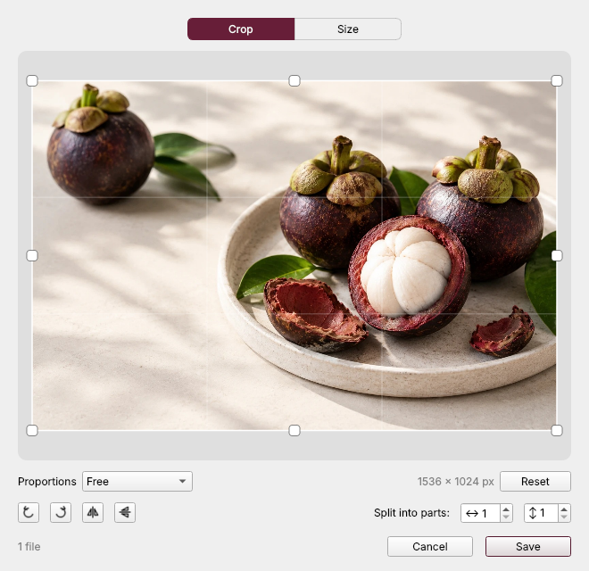
  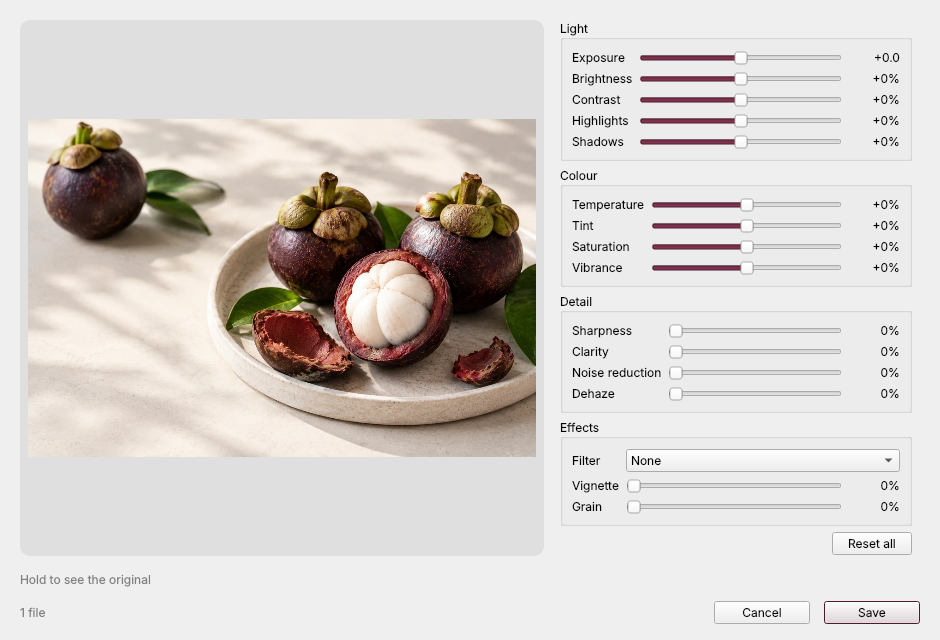
</p>
<p align="center">
  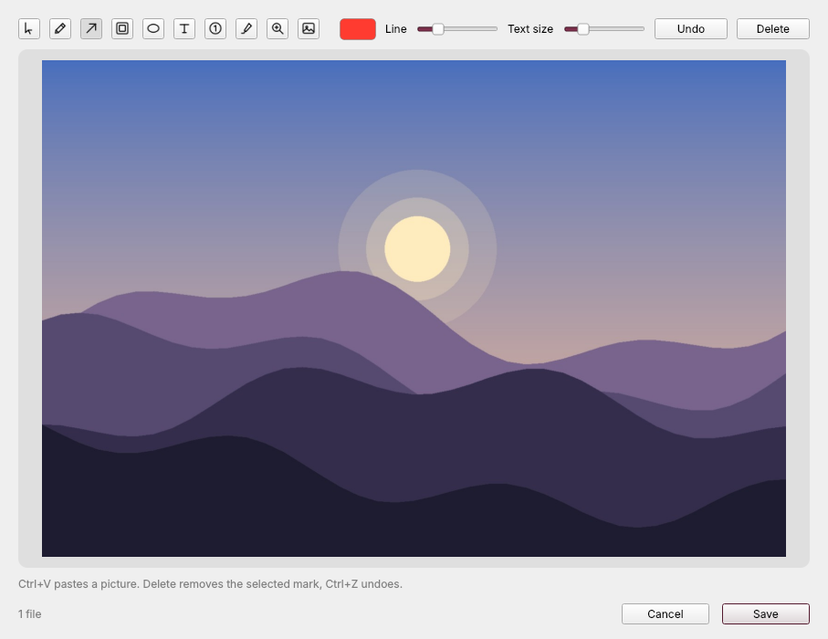
  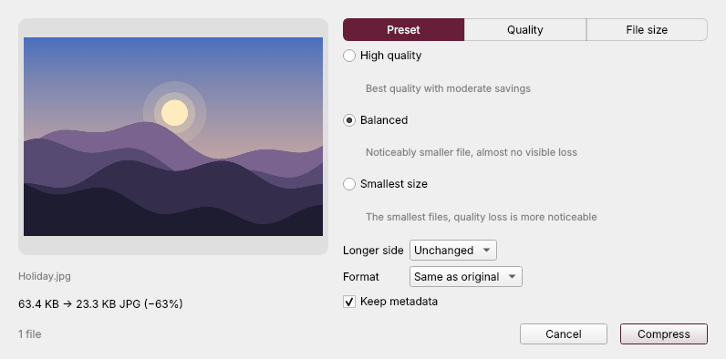
</p>
<p align="center">
  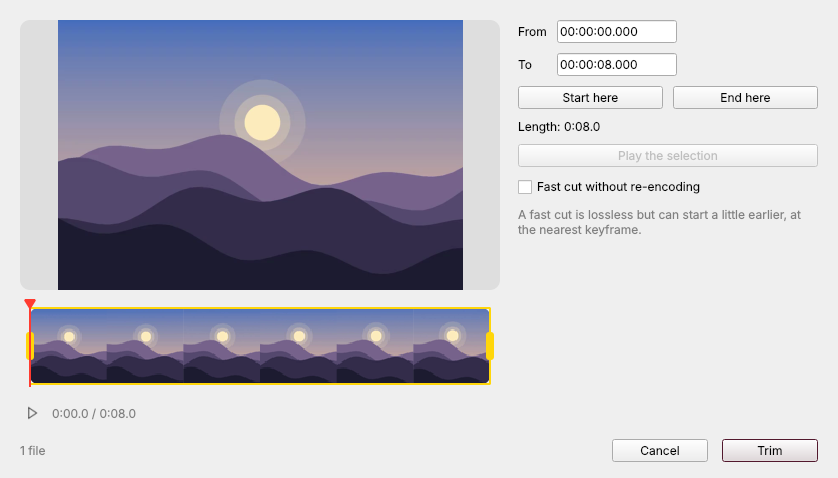
  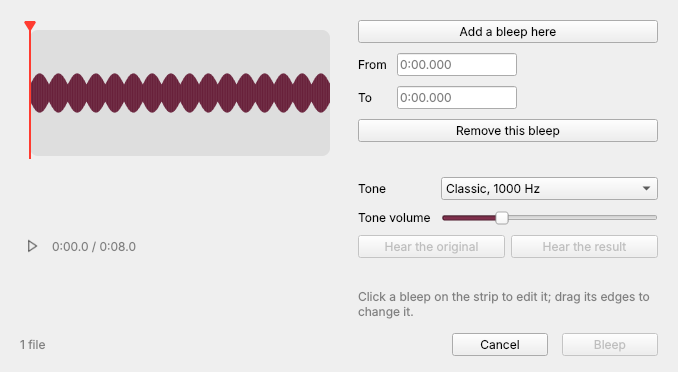
</p>
<p align="center">
  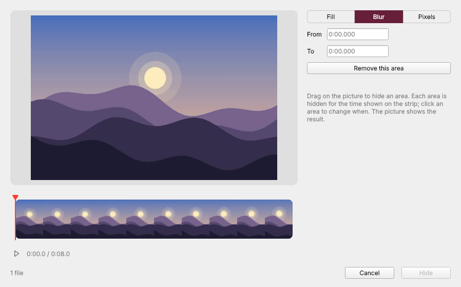
  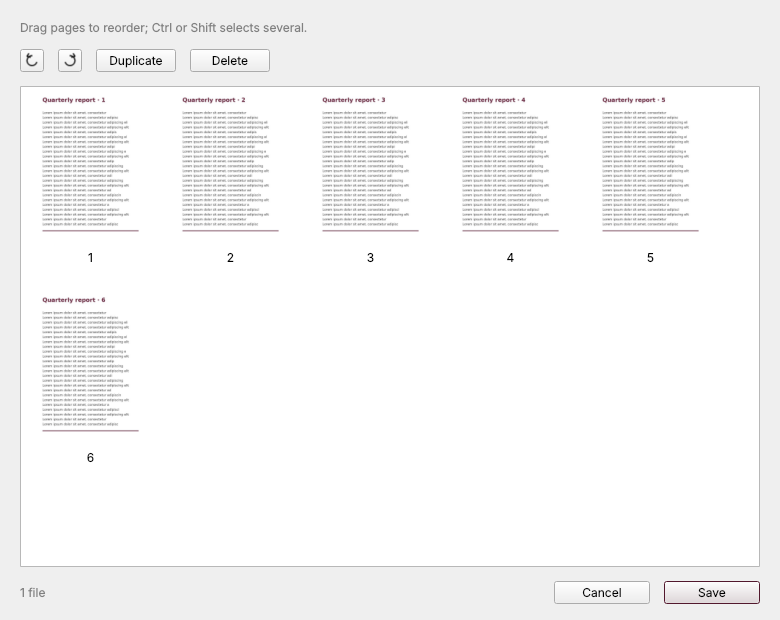
</p>

## Actions

**Float** is a small shelf that keeps files while you work: drop files on it and drag them out again to another window.
Also: **Copy** (as files, ready to paste in another app), **Path** (copies the full path), **Move…** and **Terminal**
(opens your terminal in the file's folder).

## Without a drag: tray, menus, command line

Mangosteen also works when a drag cannot be watched (Wayland, or a file manager that starts no drag):

- **Tray menu.** *Convert…*, *Tools…* and *Actions…* open a wheel for files you choose; the Float shelf; recent results
  (*Show in the file manager*, *Open*, *Delete Result*) and *Clear History*; Settings, Welcome, the log, Quit.
- **File manager menus.** A **Mangosteen** submenu in the right-click menu of Dolphin and other KDE programs, Nemo
  actions, and the Scripts menu of GNOME Files, Caja and Nemo; other file managers that read desktop actions list them
  too. Switch them in Settings.
- **Command line.**

```bash
mangosteen --wheel convert photo.heic        # the wheel at the pointer
mangosteen --tool tool.crop photo.jpg        # a tool window
mangosteen --convert pdf scan1.jpg scan2.jpg # no windows: convert right here
mangosteen --formats clip.mov                # what clip.mov can become
mangosteen --settings | --welcome | --quit
```

### X11 and Wayland

Seeing a drag in another application's window is only possible in an **X11 session**. Mangosteen watches the X
server's drag-and-drop selection and, on a GTK or Qt file manager, learns which files you are dragging. In a **Wayland
session** (the default on GNOME, and on Raspberry Pi OS with a Pi 4 or 5) the file manager is a native Wayland window
whose drags no other program can see, so the drag gesture is switched off there and the tray, the file manager menus
and the command line are used instead. Choosing an X11 session at login (or `raspi-config` on a Raspberry Pi) brings the
gesture back. `--no-drag` turns the watching off on X11 too, and `MANGOSTEEN_WATCH_DRAGS_ON_WAYLAND=1` forces it on in a
Wayland session whose file manager runs under XWayland.

## Install

**AppImage** (everything included, including FFmpeg):

```bash
chmod +x Mangosteen-*-x86_64.AppImage && ./Mangosteen-*-x86_64.AppImage
```

**Debian, Ubuntu and derivatives** (uses the system's FFmpeg and Tesseract):

```bash
sudo apt install ./mangosteen_*_amd64.deb
```

**From source** (Python 3.10 or newer; FFmpeg and Tesseract from your distribution):

```bash
python3 -m venv .venv && . .venv/bin/activate
pip install .            # add ".[background]" for the optional background-removal model runtime
mangosteen
```

Packages from your distribution that make everything work: `ffmpeg`, `tesseract-ocr` (plus `tesseract-ocr-rus`,
`tesseract-ocr-spa`…) for text recognition, and on X11 `libxcb-cursor0`. Without FFmpeg the video and audio segments are
left off the wheel; without Tesseract the text tool and the find-text button are disabled.

## Settings

Which key opens which wheel (or none), whether the wheel opens while you drag, the language, quality of JPEG, HEIC, AVIF
and WebP, keeping metadata, sounds, showing results in the file manager, the terminal to use, whether Float moves or
copies files, starting at login and the file manager menus. Everything is in one window: tray icon → **Settings…**.

## Build and test

```bash
pip install -e ".[dev]"
pytest                                   # the engines, the windows and the X11 drag detection
python scripts/check_translations.py     # every string has a Russian and a Spanish translation
python scripts/readme_images.py          # regenerates docs/images
packaging/build-bundle.sh && packaging/build-deb.sh && packaging/build-appimage.sh
```

The drag detection is tested against a virtual X server (Xvfb) with synthetic drags from GTK and Qt programs; run
`tests/xvfb_drag_scenario.py` for the full scenario. Packages are built by [GitHub Actions](.github/workflows/build.yml).

## Privacy and licenses

Nothing leaves your computer: see [PRIVACY.md](PRIVACY.md) and [SECURITY.md](SECURITY.md). Mangosteen is
[MIT-licensed](LICENSE); the components it builds on are listed in [THIRD-PARTY-NOTICES.md](THIRD-PARTY-NOTICES.md).
