[English](README.md) · *Русский*

<p align="center">
  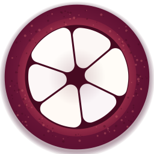
</p>

<h1 align="center">Mangosteen для Linux</h1>

<p align="center">
  <b>Конвертер файлов и набор инструментов для Linux — без лишних кликов.</b><br>
  Начните тащить файл, коротко нажмите Shift, Ctrl или Alt, бросьте файл на сегмент — готово.
</p>

<p align="center">
  
  
  
  
  <a href="LICENSE"></a>
</p>

---

Версия [Mangosteen](https://github.com/SpaceCadet0/Mangosteen) для Linux, родственная приложениям для macOS и
[Windows](https://github.com/SpaceCadet0/Mangosteen-Windows). Живёт в системном трее и ждёт перетаскивания. Начните
тащить файлы из файлового менеджера, нажмите клавишу-модификатор — и у курсора откроется круглое колесо. Бросьте файлы
на сегмент, и результат появится рядом с оригиналом. Никаких окон, диалогов сохранения, загрузок в интернет и
ограничений. Приложения не делят код; у каждого свои релизы.

<p align="center">
  <br>
  <sub><a href="docs/media/mangosteen-demo.mp4">Смотреть в MP4</a></sub>
</p>

## Установка

Самый быстрый способ: скачать AppImage, сделать его исполняемым и запустить. Ничего не устанавливается, права
администратора не нужны, FFmpeg уже внутри.

```bash
wget https://github.com/SpaceCadet0/Mangosteen-Linux/releases/download/v0.2.1/Mangosteen-0.2.1-x86_64.AppImage
chmod +x Mangosteen-0.2.1-x86_64.AppImage
./Mangosteen-0.2.1-x86_64.AppImage
```

Mangosteen появится в системном трее и добавит себя в меню приложений; окно приветствия покажет, как им пользоваться.
Все версии — на странице [Releases](https://github.com/SpaceCadet0/Mangosteen-Linux/releases).

### Другие способы установки

**Debian, Ubuntu, Linux Mint и производные** — пакет .deb ставит Mangosteen в `/opt/mangosteen` и подтягивает FFmpeg и
Tesseract из пакетов системы:

```bash
wget https://github.com/SpaceCadet0/Mangosteen-Linux/releases/download/v0.2.1/mangosteen_0.2.1_amd64.deb
sudo apt install ./mangosteen_0.2.1_amd64.deb
```

**Из исходников** — для любой архитектуры, в том числе ARM (Raspberry Pi), нужен Python 3.10 или новее:

```bash
sudo apt install git ffmpeg tesseract-ocr libxcb-cursor0     # или аналоги в вашем дистрибутиве
git clone https://github.com/SpaceCadet0/Mangosteen-Linux && cd Mangosteen-Linux
python3 -m venv ~/.local/share/mangosteen-venv && . ~/.local/share/mangosteen-venv/bin/activate
pip install .            # ".[background]" добавляет среду для необязательной модели удаления фона
mangosteen
```

### Требования

| | AppImage | .deb | Из исходников |
|---|---|---|---|
| Процессор | x86_64 | x86_64 (amd64) | любой, включая ARM64 |
| Система | glibc 2.35 или новее: Ubuntu 22.04+, Debian 12+, Linux Mint 21+, Fedora 36+, Arch, openSUSE Tumbleweed | Debian 12+, Ubuntu 22.04+ и производные | Python 3.10+ и системные библиотеки, нужные Qt 6 |
| FFmpeg (видео и аудио) | внутри | ставится вместе с пакетом | установить самому |
| Tesseract (распознавание текста) | установить самому | ставится вместе с пакетом (рекомендуемая зависимость) | установить самому |

- **Рабочий стол.** В сеансе X11 работает всё. В сеансе Wayland жест перетаскивания отключён, а колесо открывается из
  трея, меню файлового менеджера и командной строки (см. [X11 и Wayland](#x11-и-wayland)).
- **Необязательные части.** Без FFmpeg сегменты видео и аудио не показываются на колесе; без Tesseract инструмент
  «Текст» и кнопка поиска текста отключены. Языки распознавания — отдельные пакеты (`tesseract-ocr-rus`,
  `tesseract-ocr-spa`…).
- **AppImage и FUSE.** Если AppImage не запускается, установите FUSE 2 (`sudo apt install libfuse2`, в Ubuntu 24.04 —
  `libfuse2t64`) или запустите его с ключом `--appimage-extract-and-run`.
- **Raspberry Pi.** Проверено на Raspberry Pi 5 с 64-битной Raspberry Pi OS (Bookworm), установка из исходников. Для
  жеста нужен сеанс X11: `sudo raspi-config` → Advanced Options → Wayland → X11.
- **Обновление.** Значок в трее → **Проверить обновления…** (или кнопка в окне «О Mangosteen»): окно покажет, что
  нового, и установит новую версию. AppImage заменит сам себя, .deb установится после запроса пароля, копия,
  установленная из исходников через `pip install .`, переустановится из релиза. Затем Mangosteen перезапустится.
- **Удаление.** Сначала выключите в настройках меню файловых менеджеров и запуск при входе, затем закройте Mangosteen.
  AppImage: удалите файл и `~/.local/share/applications/mangosteen.desktop`. .deb: `sudo apt remove mangosteen`.
  Настройки остаются в `~/.config/mangosteen`, история — в `~/.local/state/mangosteen`, если хотите удалить и их.

## Как это работает

<p align="center">
  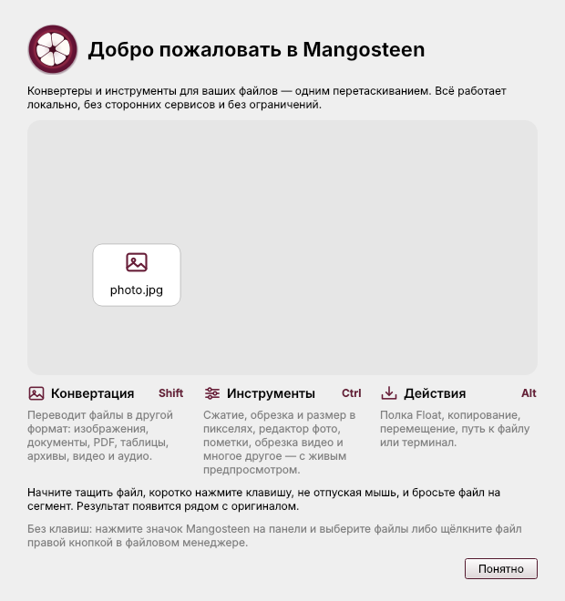
</p>

| Нажать во время перетаскивания | Колесо | Что делает |
|:---:|:---:|---|
| `Shift` | **Конвертация** | Переводит файлы в другой формат |
| `Ctrl` | **Инструменты** | Открывает редактор с живым предпросмотром |
| `Alt` | **Действия** | Полка Float, копирование, перемещение, путь, терминал |

Клавиши настраиваются. Начните тащить файл, коротко нажмите клавишу (нажать и отпустить), не отпуская мышь, — колесо
появится у курсора; бросьте файл на сегмент. Открылось не то колесо? Нажмите другую клавишу, чтобы переключиться.

<p align="center">
  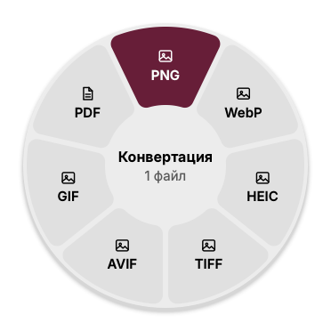
  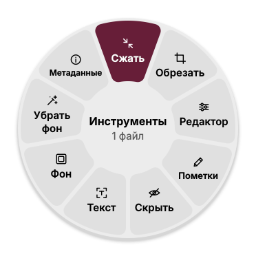
  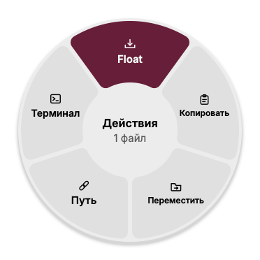
</p>

## Главное

- **Без лишних кликов.** Колесо показывает только то, что подходит для перетаскиваемых файлов.
- **Оригинал не трогает.** Результат записывается рядом с исходным файлом; имена не конфликтуют (`photo 2.jpg`).
- **Полностью офлайн.** Всё работает на вашем компьютере. Ничего не отправляется, ничего не отслеживается.
- **Без ограничений.** Любое число файлов, любой размер, сколько угодно раз.
- **Родное приложение.** Qt 6, светлая и тёмная тема системы, уведомления рабочего стола, работа из трея.
- **Три языка.** Английский, испанский и русский — по системе или по выбору в настройках.

## Конвертация

| Тип | Форматы |
|---|---|
| Изображения | PNG, JPG, WebP, HEIC, TIFF, AVIF, GIF, PDF (несколько фото собираются в один PDF); читает также BMP, ICO, ICNS, SVG, PSD, JPEG 2000, TGA |
| PDF | в PNG или JPG (несколько страниц — папка страниц), TXT, Markdown, RTF, DOCX, HTML |
| Документы | DOCX, ODT, RTF, TXT, Markdown, HTML друг в друга и в PDF |
| Таблицы | CSV, TSV, XLSX |
| Субтитры | SRT, VTT, TXT |
| Видео | MP4, MOV, MKV, WebM, AVI, WMV друг в друга, GIF и MP3 |
| Аудио | MP3, M4A, WAV, FLAC, OGG, Opus, AIFF, WMA |
| Архивы и папки | ZIP, TAR, TGZ |

Для видео и аудио нужен FFmpeg (он внутри AppImage и указан зависимостью у .deb). Форматы, которые нельзя записать
(например, HEIC без своей библиотеки), просто не показываются на колесе, а не падают с ошибкой потом.

## Инструменты

Каждый инструмент открывает окно с живым предпросмотром, сохраняет результат рядом с оригиналом и не меняет сам оригинал.

| Инструмент | Что делает |
|---|---|
| **Обрезать** и **Размер** | Обрезка мышью, по пропорциям или точным пикселям; поворот и отражение; разрезание на сетку частей; пакетное изменение размера в пикселях, процентах или по длинной стороне |
| **Редактор** | Экспозиция, контраст, света и тени, температура, насыщенность, резкость, чёткость, дымка, фильтры, виньетка и зерно |
| **Пометки** | Стрелки, фигуры, текст, нумерованные метки, маркер, лупа и вставленные картинки |
| **Скрыть** | Закрывает лица, текст или любую область заливкой, размытием или пикселями; восстановить нельзя, метаданных в результате нет |
| **Сжать** | Фото, PDF, видео и аудио: по пресету, качеству или целевому размеру, с живой оценкой размера |
| **Фон** | Помещает фото на цвет, градиент, размытую копию или другую картинку — с рамкой и скруглёнными углами |
| **Убрать фон** | Вырезает объект; работает встроенным методом или моделью IS-Net, если вы её скачаете (необязательно) |
| **Коллаж** | Несколько фото сеткой, рядом, столбцом или с одним главным фото |
| **Метаданные** | Читает и правит EXIF (автор, описание, авторские права, камера, дата съёмки), убирает геопозицию; JPEG правится без изменения пикселей |
| **Текст** | Распознаёт текст на фото и в PDF (нужен Tesseract) |
| **Разделить PDF**, **Порядок страниц**, **Объединить** | Разрезать PDF, менять порядок, поворачивать, дублировать и удалять страницы, склеивать PDF |
| **Обрезать**, **Разделить**, **Кадры** | Резка видео и аудио на ленте с кадрами или волной; сохранение кадров картинками |
| **Скорость**, **Громкость**, **Каналы** | Изменить скорость (с тоном или без), выровнять громкость за два прохода, стерео и моно |
| **Запикать**, **Визуализатор** | Заменить слова тоном; превратить песню в видео с волной или спектром |
| **Кадрировать**, **Скрыть**, **Склеить** | Обрезать кадр видео, скрыть области видео на нужное время, склеить видео |
| **Распаковать** | Распаковать архивы |

<p align="center">
  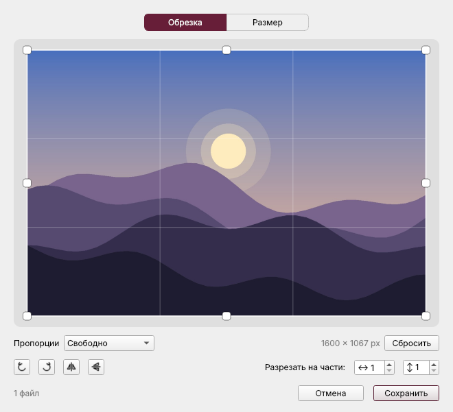
  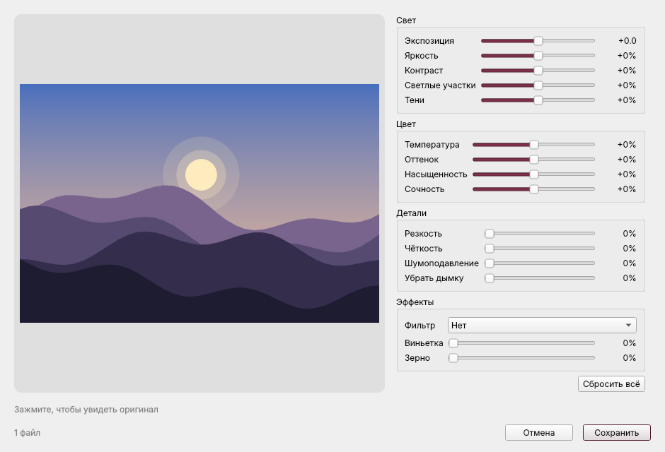
</p>
<p align="center">
  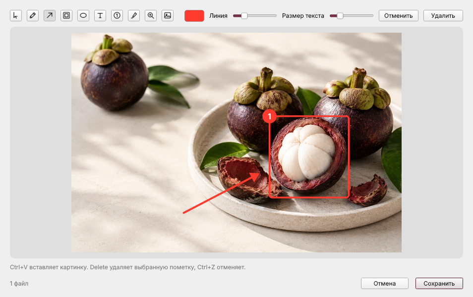
  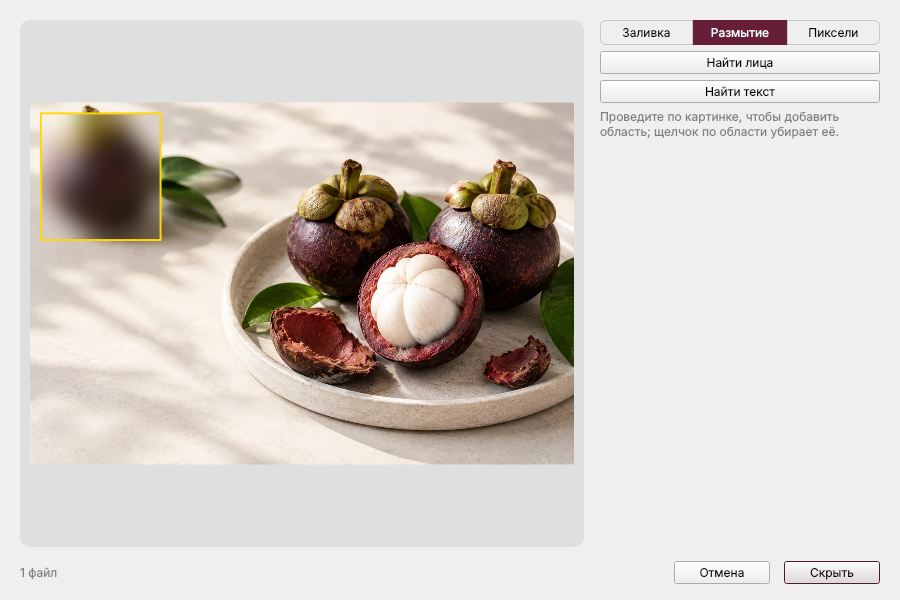
</p>
<p align="center">
  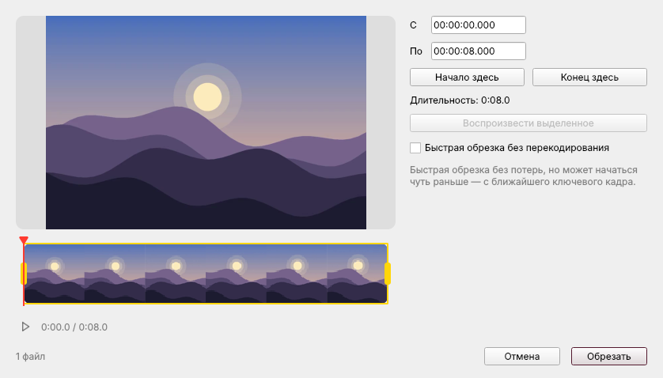
  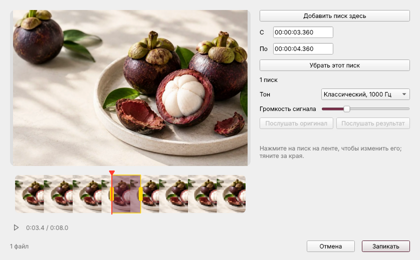
</p>
<p align="center">
  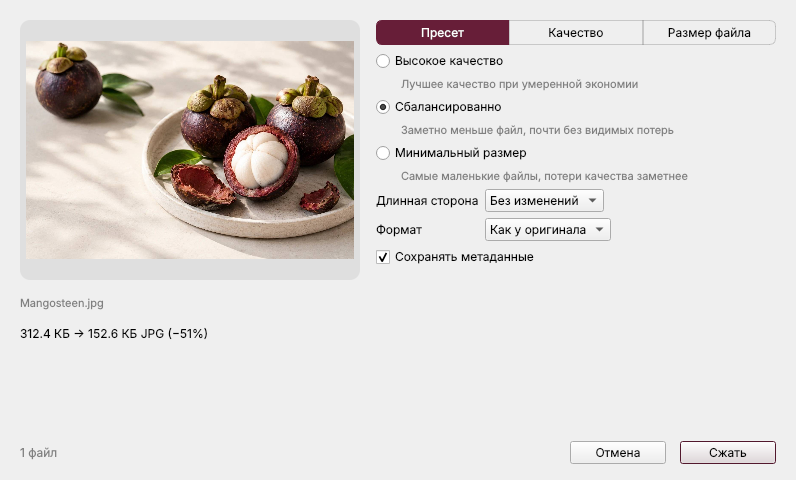
  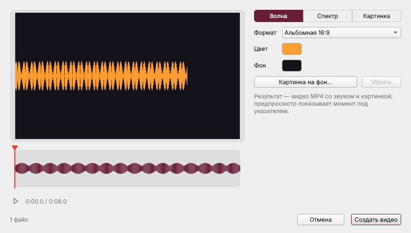
</p>
<p align="center">
  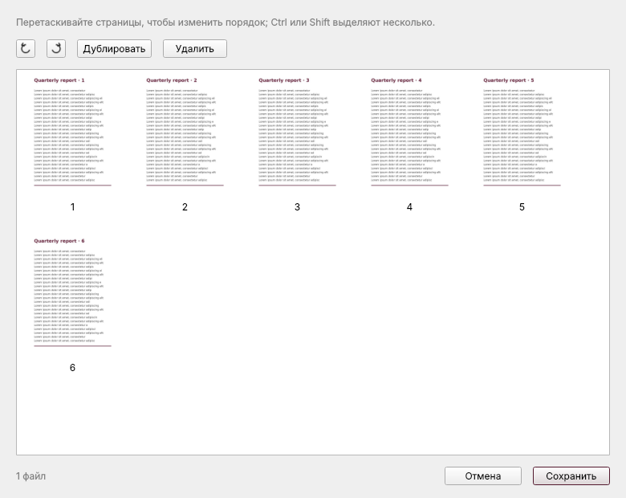
  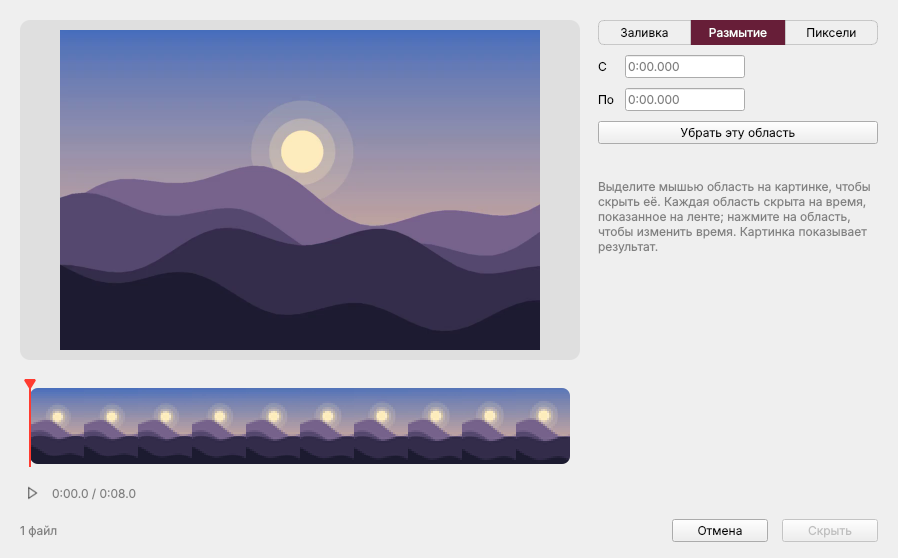
</p>

## Действия

**Float** — небольшая полка, которая хранит файлы, пока вы работаете: бросьте на неё файлы и потом вытащите их в другое
окно. Ещё: **Копировать** (как файлы, чтобы вставить в другом приложении), **Путь** (копирует полный путь),
**Переместить…** и **Терминал** (открывает ваш терминал в папке файла).

## Без перетаскивания: трей, меню, командная строка

Mangosteen работает и там, где перетаскивание увидеть нельзя (Wayland или файловый менеджер без перетаскивания):

- **Меню в трее.** *Конвертация…*, *Инструменты…* и *Действия…* открывают колесо для выбранных файлов; полка Float;
  недавние результаты (*Показать в файловом менеджере*, *Открыть*, *Удалить результат*) и *Очистить историю*;
  настройки, приветствие, журнал, выход.
- **Меню файловых менеджеров.** Подменю **Mangosteen** в контекстном меню Dolphin и других программ KDE, действия Nemo и
  меню «Скрипты» в GNOME Files, Caja и Nemo; другие файловые менеджеры, читающие действия .desktop, тоже их покажут.
  Включается в настройках.
- **Командная строка.**

```bash
mangosteen --wheel convert photo.heic        # колесо у курсора
mangosteen --tool tool.crop photo.jpg        # окно инструмента
mangosteen --convert pdf scan1.jpg scan2.jpg # без окон: конвертировать прямо здесь
mangosteen --formats clip.mov                # во что можно превратить clip.mov
mangosteen --settings | --welcome | --quit
```

### X11 и Wayland

Увидеть перетаскивание в окне другой программы можно только в **сеансе X11**. Mangosteen следит за выделением
перетаскивания X-сервера и в файловых менеджерах на GTK и Qt узнаёт, какие файлы вы тащите. В **сеансе Wayland** (он по
умолчанию в GNOME и в Raspberry Pi OS на Pi 4 и 5) файловый менеджер — родное окно Wayland, чужое перетаскивание в нём
не видно никому, поэтому жест там отключён, а вместо него работают трей, меню файловых менеджеров и командная строка.
Выбор сеанса X11 при входе (на Raspberry Pi — `raspi-config`) возвращает жест. Ключ `--no-drag` отключает слежение и
на X11, а `MANGOSTEEN_WATCH_DRAGS_ON_WAYLAND=1` включает его принудительно в сеансе Wayland, где файловый менеджер
работает через XWayland.

## Настройки

Какая клавиша открывает какое колесо (или никакая), открывать ли колесо во время перетаскивания, язык, качество JPEG,
HEIC, AVIF и WebP, сохранение метаданных, показ результатов в файловом менеджере, терминал, перемещает или
копирует Float файлы, запуск при входе и меню файловых менеджеров. Всё в одном окне: значок в трее → **Настройки…**.

## Сборка и тесты

```bash
pip install -e ".[dev]"
pytest                                   # движки, окна и определение перетаскивания на X11
python scripts/check_translations.py     # у каждой строки есть русский и испанский перевод
python scripts/readme_images.py          # пересоздаёт docs/images
packaging/build-bundle.sh && packaging/build-deb.sh && packaging/build-appimage.sh
```

Определение перетаскивания проверяется на виртуальном X-сервере (Xvfb) с искусственными перетаскиваниями из программ на
GTK и Qt; полный сценарий — `tests/xvfb_drag_scenario.py`. Пакеты собирает
[GitHub Actions](.github/workflows/build.yml).

## Конфиденциальность и лицензии

Ничего не покидает ваш компьютер: см. [PRIVACY.md](PRIVACY.md) и [SECURITY.md](SECURITY.md). Mangosteen распространяется
по [лицензии MIT](LICENSE); используемые компоненты перечислены в [THIRD-PARTY-NOTICES.md](THIRD-PARTY-NOTICES.md).
